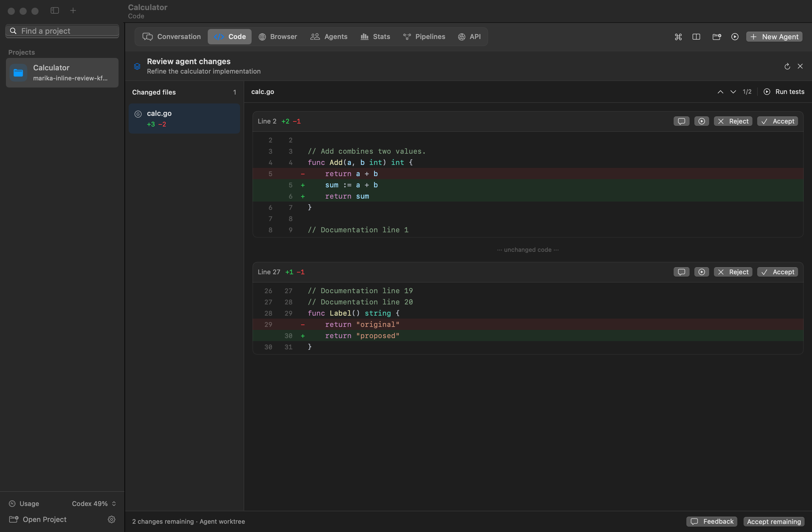

# Marika

[](https://github.com/junkd0g/marika/actions/workflows/ci.yml)
[](LICENSE)

A native macOS workbench for coding agents. Open a project, pick an agent, and work through a
conversation with live tool activity, approvals, diffs and plan usage in one window.

Marika runs the official `claude` and `codex` command-line tools, so your existing Claude or
ChatGPT plan works, and each session can use a different agent.

**macOS 15+ · Swift 6 · Claude and Codex · MIT licensed**



Build instructions are [below](#run-it). See [CONTRIBUTING.md](CONTRIBUTING.md) to get involved
and [SECURITY.md](SECURITY.md) to report a vulnerability privately.

Unsent prompts and image attachments are saved automatically and restored when you reopen the
app. Use the sidebar to find and switch projects. Each project opens its own conversation.
If an edited file has disappeared or become unreadable, its saved draft stays editable and can
be saved as a copy. Workspace and transcript files have a last good backup; Marika recovers it
automatically when possible and keeps damaged originals for inspection. Storage errors appear
at the top of the window with **Open Saved Data** and **Try Again**. Failed saves remain pending.
New sessions offer starting prompts you can review before sending. Account and billing changes
take effect after any active turn finishes, so changing settings doesn't cut off your agent.

Organize projects into **spaces** in the left sidebar. The colored icons at the bottom switch
spaces; **+** creates one. Each space remembers its last project, chat, and editor state. New
projects belong to the current space. Right-click a project and choose **Move to Space**.
Use a space's menu to edit its name, icon and color, change its position,
or delete it. Deleting a space moves its projects to the space named in the confirmation;
files and conversations are kept. Existing projects start in **Personal**. **⌃⌥← / ⌃⌥→** switch
spaces, and **Navigate → Switch Space** and the command palette list them by name. Running
agents keep working when you switch, with activity dots on their space icons.

The chat composer has separate **model**, **reasoning effort**, and **speed** controls for Codex.
Speed offers Standard plus the faster tiers advertised by the selected model, including Fast
or Ultrafast when available. **Default speed** follows your Codex configuration. Each chat keeps
its own choice across restarts; changes apply to the next turn. Narrow windows wrap the controls
onto two rows so the speed selector remains accessible. Light and dark chat layouts use quiet
project navigation, neutral message bubbles, and a rounded composer.

Use **+** in a project's top bar to open **Code**, **Stats**, **Browser**, **Agents**, **Pipelines**,
**API**, **Changes**, or **Terminal** as a tab. **Chat** stays pinned at the beginning. Opening a
view again selects its existing tab. Each tool tab has an **×** to close it; its context menu can
close other tabs or move it left or right. Each project remembers its open tabs, order and selected
view across restarts. Closing a tool tab keeps unsaved editor files and running tasks available
when you reopen it. **⌃Tab / ⌃⇧Tab** cycle through open tabs; **⌘1–9** open or select a view directly.

Chat includes a **#project** channel and direct conversations with the project's agents, with live status, unread replies and agent search. Type **@** to choose an agent, then send a message to its conversation. Drafts and attachments stay with each chat, and switching projects or tabs restores your last conversation. The outer sidebar remains project-only.

Use **Search chat history** in the chat header, or **⇧⌘H**, to search messages across all projects
in a separate window overlay. Filter by project and open a result to jump to the original message,
highlighted in its conversation. **Latest** returns to the end of the chat. Search reads saved and
live conversations locally; it sends no messages to a provider and leaves your drafts intact.

**Marika → Check for Updates…**, **Release Notes…**, and **Settings → Updates** show the installed
version and build, release notes, and the latest published GitHub release. Checks run when you ask.
No published release is reported separately from being up to date, and network failures remain
visible with a retry action. Release builds configured with an appcast and public signing key offer
**Download and Install…** through Sparkle, which verifies signed archives and feeds. Installation
checks for working agents and unsaved or saving editor documents before allowing a restart.
Development builds without a signing feed can check releases and open their download page.

In Code, browse folders and edit multiple
files with line numbers, language-aware syntax colours, undo, and Find (⌘F). Save with ⌘S. Unsaved
buffers stay open when switching conversations, and Marika asks before discarding edits. Files
changed on disk reload automatically when clean; conflicting edits are preserved for review.
Right-click a local file, folder, or open file tab and choose **Move to Trash…** to delete it.
With the Files list focused (⇧⌘E), Delete or ⌘Delete opens the same confirmation. Unsaved edits
stay open as recovered drafts, and saved files can be restored from the Mac's Trash.
The editor supports UTF-8 and UTF-16 text files up to 2 MB. Single-click a file to open it.
Light and dark palettes distinguish keywords, types, functions, strings, and comments, including
Go, Swift, TypeScript, Python, GraphQL, and Protocol Buffers. The editor uses a monospaced font,
configurable tab stops, indentation guides, and matching-bracket highlights. Use the sliders button
in the editor toolbar (or **Settings → Editor**) to set the font size, light/dark theme, tabs or
spaces, tab width, guides, and line wrapping. These preferences update open editors immediately.
The slim file tabs sit above one toolbar; click a breadcrumb to browse and filter that folder.
Rename, refactoring, formatting, and snippets are in the **…** menu and the code context menu.

Markdown files open in **Preview**. Use **Edit** for the highlighted Markdown source or **Split**
to edit beside a live preview of your unsaved changes. The preview renders headings, tables,
checklists, code blocks and images. Relative images and document links resolve from the Markdown
file's folder within the project; heading links jump within the preview. Your chosen view and
unsaved source are restored with the file. Switching views preserves the editor's undo history.
Narrow split panes stack vertically, and ⌘F opens the source editor's search bar.
Images, PDFs, audio, video, and other files open in an embedded Quick Look preview, using the
preview formats installed on your Mac. Large text files use a preview instead of the editor.

Open **Changes** (⌘8) from the Project menu to review staged and working-tree changes. Stage or
unstage a file or individual hunk, revert working changes after confirmation, and click a line
number to add feedback to the current chat draft. Commit the staged changes, push the branch,
and create a pull request with GitHub CLI. Push and PR creation run only when you choose them.

Open **Terminal** (⌘9 or ⌃`) for interactive shells in the project and its agent worktrees. The + menu
opens another shell; closing a shell stops its processes. **Send output to chat** adds the current
terminal output to your draft. Project actions run in the selected shell.

**Project → Project Settings** (⇧⌘,) contains worktree setup, reusable actions, schedules,
playbooks and MCP connections. Setup runs before each isolated agent starts and a setup failure
stops that launch. **Chat → Scheduled jobs** manages recurring agent tasks, with fixed hourly
intervals or five-field cron expressions, time zones, presets and a next-run preview. For example,
`0 9 * * MON-FRI` runs at 9am on weekdays in the chosen time zone. Edit, pause, resume or run jobs
manually and open their saved run conversations to follow up. The latest 12 runs are linked from
each job; their transcripts remain saved in the project. Jobs use isolated worktrees in Git
repositories and request approval when needed. They run while Marika is open and the Mac is awake,
catch up one missed run after reopening, and don't overlap runs of the same job. Cron supports
lists, ranges, steps, month/day names and calendar aliases such as `@daily`; missing DST times
are skipped and repeated local times run once. Keep the app running for scheduled work.

Enabled project playbooks are sent to Claude and Codex on their next process connection. Import
an existing SKILL.md or create instructions in the editor. Open **Project → MCP Servers** to add,
edit, enable or disable servers for this project. Connect local commands or HTTP endpoints;
**Test connection** initializes a temporary connection and lists tools, resources and prompts
without executing tools. Import existing `mcpServers` JSON or use Advanced JSON for extra options.
Use `${ENVIRONMENT_VARIABLE}` references for existing credentials. Changes reconnect idle agents
and take effect after active work finishes. CLI-level skills and configured tools also remain
available through their respective agent runtimes.

HTTP servers that publish OAuth metadata offer **Sign in**. Marika opens the authorization page
in your browser, uses PKCE, and stores access and refresh tokens in macOS Keychain. Servers can
register a public client automatically or use the optional client ID in the server editor.
Tokens refresh before agent connections and connection checks; **Sign out** removes the local
credential. The project stores only an opaque credential reference. OAuth credentials are local
to this Mac and project. Existing provider consent is managed at the provider.

Use the folder button in the workspace toolbar to attach repositories to a project and switch
their editors and Git review. Open files and unsaved drafts are saved separately per repository.
The project conversation can work across attached folders; isolated task agents stay inside their
own worktree. Scans and generated API collections continue to belong to the primary repository.

The workspace tools menu includes **Checkpoints**, **Runtime Debugging**, and **Plans and Artifacts**.
Checkpoints capture saved files before an agent turn and compare them after it finishes. Restore
refuses to overwrite later edits or unsaved editor drafts. It restores code only, leaving chat,
commits, and Git's index intact. Git-ignored files and symlinks are excluded, with limits of 5 MB
per file and 100 MB per snapshot. The latest 12 completed snapshots per project are retained.

Runtime Debugging runs a reproduction command for up to two minutes, saves its exit status and
bounded output, and can hand the evidence to the project agent for diagnosis and verification.
Plans and Artifacts stores agent-authored plans and reports, review comments anchored to lines,
and screenshot sequences of agent browser actions. **Draft plan** starts a read-only planning
agent; **Approve and implement** continues it in the standard approval mode. Artifacts can be
reviewed across projects without putting chats in the sidebar. Agent claims in reports still
need to be assessed against their recorded evidence.

Project Settings also contains **Memory**, **Hooks**, **Remote**, and **Editor**. Memory is shared
with new Claude and Codex connections. Hooks run explicitly configured commands before or after
turns. Remote entries use your SSH configuration to open a shell or the remote machine's installed
agent CLI; they do not synchronize files or mirror the remote conversation into Marika's chat.
Use the editor's sparkles button for an AI suggestion, Tab to insert it, and Escape to dismiss it.
Automatic suggestions are opt-in and use the selected agent and model's existing CLI account.

The Code toolbar now connects to language servers for diagnostics, completions, definitions,
references, hover help, signatures, symbols, formatting, and refactoring previews. Go support
uses bundled `gopls`; Swift and C/C++ use installed Apple tools. GraphQL and Protobuf
presets connect to installed `graphql-lsp` and `buf lsp serve` tools. Configure other servers or import
Marika language-extension JSON in **Project Settings → Editor**. These are declarative Marika
integrations, not VS Code VSIX extensions. Format-on-save is opt-in.

With a language server configured, completion suggestions appear beside the cursor as you type.
Control-Space opens them manually; use the arrow keys to choose, Tab or Return to insert, and
Escape to dismiss. Hover a symbol for documentation, or use Control-Shift-Space for the current
function signature. Diagnostics show a lightbulb in the gutter: click it, hover the underlined
code, or press Option-Return to see quick fixes. Single-file fixes and completion edits (including
imports) are undoable; fixes spanning multiple files open a review before applying.

⌘-click a symbol or press F12 to go to its definition. ⌥⌘-click, Option-F12, or **Peek Definition**
opens a source preview without switching files. Shift-F12 shows references. Use the arrow keys
and Return in the preview, or choose **Open file**. Back and Forward retain cursor locations,
including jumps within one file. Only files inside the current project are opened by language
navigation. Unsaved content is used in previews.

Compiler locations and stack frames in Terminal are clickable. Go, Swift, TypeScript and Python
locations open the matching project file and line. Dragging still selects terminal text. Relative
paths use the shell's initial folder or its reported current folder through OSC 7.

The editor drawer contains **Problems**, **Code**, **Tests**, and **Debug**. Test discovery supports
Go, Swift, and pytest; Go results include per-test status and line coverage. Go debugging uses
bundled Delve: click the line-number gutter to add breakpoints, start Debug, and inspect stack
frames, variables, and watches. Other runtimes use the configured DAP adapter and launch JSON.
Go starts at a breakpoint rather than at runtime initialization. macOS may request debugger access.

Option-click adds a cursor, ⌘D selects the next matching occurrence, and the editor's Fold/Unfold actions
collapses a language-server block without changing saved text. The Snippets menu inserts common
language templates. Search supports regex and replacement previews; replacements become unsaved
drafts, so normal save conflict checks still apply. Changes → History & branches provides commit
history, graphs, blame, branch switching, stash operations, and three-way merge resolution.

**Remote → Open workspace** opens SSH files directly, with comparison checks before writes;
Python 3 and key-based SSH access are required on the host. Language tools, tests, and installed
agent CLIs run there. The development-container action mounts the project into a user-selected
image; the image must include the required tools. Local browser MCP tools and local checkpoints
are not bridged to remote agent sessions. Generic remote debug adapters use stdio; automatic
Delve TCP launching currently runs locally. Live SSH connectivity requires your own host and was
not exercised by the automated fixtures.

Open **Stats** (⌘5) for code-health reviews. **Run review** starts the selected agent to inspect
source and tests, then publish prioritized findings with exact code excerpts, impact and next steps.
Click a source location to open the editor or ask an agent to work on a finding. The inventory
separates maintained source, tests, generated files and dependencies. Compact language and file-size
summaries support the review. Earlier scans remain available from the date menu, and the model can
be changed from the review settings button.

Open **API** (⌘7) and choose **Generate collection** to have the current project agent read the
routes, handlers, tests and startup files. Open **Source** on a request to inspect its implementation.
The agent can publish HTTP requests, GraphQL queries and mutations, and gRPC methods in the same collection.
For GraphQL, edit the operation and its JSON variables. For gRPC, edit the protobuf JSON message and
metadata. The client uses `grpcurl` with project proto files or server reflection. Use `grpc://`
for plaintext and `grpcs://` for TLS. For HTTP, edit the path, query, headers or body, then **Send**. Use **Compare** to send the request to two
base URLs and see which JSON fields differ. **Save request** stores edits, including entered
headers, in the project's local workspace. **Project environment** shows the agent's Compose
files, profiles, command and prerequisites. **Start project** builds and starts the stack;
**Status**, **Logs**, and **Stop** operate on the same project-specific Compose stack.

Open **Pipelines** (⌘6) to select a job and event from the project’s GitHub Actions YAML.
Linux jobs run through `act` and the active Docker engine. Choose an image with the tools the job
needs. Jobs with recognized GitHub-only requirements are labeled in the picker’s detail area.
Swift packages also offer a native Mac test and release build. Marika’s own pipeline finishes by
verifying the app signature. Each project keeps its latest 12 finished runs and the last 64 KB of
output per run. Use **Run again** to repeat a job or **Ask agent about failure** to analyze its log.

Press **⌘P** from any project tab to search files by name, path, or abbreviation. The file list
also has a project-wide filter. Use **⇧⌘E** to focus it, arrow keys to browse and expand folders,
and Return to start editing. **⇧⌘[ / ⇧⌘]** switch open files. Tabs scroll to the selected file,
the open-files menu shows full paths, and breadcrumb menus let you jump to nearby files.

Use **⌘K** to find workspace commands and **⇧⌘F** to search file contents across the project.
Select a match to jump to its line in Code. Use the split menu to pair two project panels side by
side or stack them vertically. Drag the divider to resize them, or press **⌥⌘\** to toggle the
split. Marika restores the layout, browser addresses, open files, and unsaved edits on restart.

Open **Browser** (⇧⌘B) to preview a running local server or a project HTML file. It has page tabs,
back/forward navigation, desktop/tablet/mobile widths, and WebKit's Inspect Element menu. Start
a detected development server with **⇧⌘R**, or enter a custom command and address in preview settings. The browser opens when the server responds. Select an element or
capture a screenshot to add feedback to the current message draft for review before sending.

Marika provides eight browser tools to newly started Claude and Codex agent processes through
the bundled `MarikaBrowserMCP` helper. Agents can inspect, screenshot, navigate, click, fill, scroll,
and switch tabs in the same browser you see. Local previews are enabled by default; other sites
need access enabled from **Agent access** in the browser toolbar. Each project has a separate,
temporary browsing profile. This uses native WebKit; Codex desktop's private browser and CDP
developer mode are not exposed by the Codex CLI.

Use **Agents → Launch Agent** (⇧⌘N) to give Claude or Codex a task in a separate chat. Choose its
model and permissions, optionally include the selected file, and monitor progress from Agents.
Open an agent's chat to answer approval requests or give further instructions. Each agent keeps
its own conversation. Git projects use isolated worktrees by default. Choose **Review Changes**
to open a before/after diff in the code editor. Accept or reject each hunk, or accept all remaining
changes. New, deleted and binary files are reviewed as whole files. Acceptance protects unsaved
editor drafts and refuses stale reviews; refresh if the project or agent's proposal changed.
**Run tests** runs the relevant Go packages or the project's Swift, Rust, JavaScript or Python
test command in the agent's worktree. Send review feedback and failed test output directly to
that agent. Agents in non-Git folders share the project files. Up to four agent tasks can run at once.

Agents can also delegate from chat through `agent_spawn`, `agent_list`, `agent_status`, `agent_wait`,
`agent_send`, and `agent_stop`. Child agents inherit the parent's permission mode and can only be
managed by their parent or an ancestor chat. Delegation is limited to three levels. The MCP
connection is specific to each chat and is refreshed when that chat's agent process restarts.

## Status

Version 0.1, a working first build.

| Area | State |
| --- | --- |
| Claude Agent on a Claude plan | Tested end to end against the real CLI (v2.1.308) |
| Codex on a ChatGPT plan | Tested end to end against real Codex (0.166.0-alpha.6, from the ChatGPT app) |
| Claude with an API key | Environment handling is unit tested. **Not yet run with a real key** |
| Sign-in through Terminal | **Not yet exercised**, because the test Mac was already signed in |
| Liquid Glass | Not used. Panels are solid, so they look the same on every supported macOS |

The agents have different safety controls, so read [docs/approval-modes.md](docs/approval-modes.md) for
what each mode really does.

## Run it

You need macOS 15 or later, Xcode 26.3 or newer to build, and at least one agent. Marika finds Codex inside the ChatGPT
desktop app, so you only need this if you have neither:

```bash
curl -fsSL https://claude.ai/install.sh | bash
```

```bash
brew install --cask codex
```

Build and open the app:

```bash
scripts/build-app.sh
```

```bash
open build/Marika.app
```

## Signed app updates

Sparkle is pinned through SwiftPM and embedded, with its helper services, in the app bundle.
Normal development builds provide version information, release notes, and GitHub release checks.
To enable in-app installation, configure a real HTTPS appcast URL and Ed25519 public key when
building. Archives and the appcast must be signed with the matching private key.

After resolving the package, generate a release-signing key in your Keychain:

```bash
.build/artifacts/sparkle/Sparkle/bin/generate_keys --account marika-updates
```

Use the public key printed by that tool. Use a higher version and build number for each release:

```bash
MARIKA_VERSION=0.2.0 MARIKA_BUILD_NUMBER=2 \
MARIKA_UPDATE_FEED_URL=https://github.com/junkd0g/marika/releases/latest/download/appcast.xml \
MARIKA_UPDATE_PUBLIC_KEY='<your public key>' \
scripts/build-app.sh release
```

For distribution to other Macs, set `MARIKA_SIGNING_IDENTITY` to a Developer ID Application
identity and notarize the app before packaging it. The build script embeds and signs Sparkle's
framework and helper services, preserves their entitlements, and removes local SwiftPM search
paths from the packaged executable. Developer ID builds use hardened runtime and timestamping.

Prepare a signed archive and feed locally, supplying your Markdown release notes:

```bash
python3 scripts/package-update.py \
  --download-prefix https://github.com/junkd0g/marika/releases/download/v0.2.0/ \
  --notes /path/to/release-notes.md
```

The command verifies the archive against the public key embedded in the app and verifies the
signed appcast. It writes `build/update-release/Marika-0.2.0.zip` and `appcast.xml`; it does not
publish them. Attach those files to the corresponding GitHub release and use the same notes
as the release description. Keep the private key in Keychain; CI can instead provide its path
with `--private-key-file`. No private signing key is embedded in the app or committed to Git.

`python3 scripts/test-update-package.py` verifies the packaging flow with an inert fixture app
and temporary keys, including mismatched-key and tampered-file rejection. CI runs this check
after building the app.

## How it fits together

```
Sources/
  MarikaCore/              Engine. No UI, so it can be tested headless.
    Agents/
      AgentSession.swift   The protocol every agent implements
      Claude/              Claude Code CLI over stream-json
      Codex/               codex app-server over JSON-RPC
    Model/                 Transcript, diffs, approvals, events shared by all agents
    Services/              SessionController (events to transcript), git, Keychain, storage
    Support/               Subprocess handling, login-shell environment, JSON
  Marika/                  The SwiftUI app
  MarikaBrowserMCP/        Local MCP bridge to the browser and agent tasks
Tests/MarikaCoreTests/     Replays recordings of the real tools, plus stand-in Codex servers
```

To add an agent, implement `AgentSession` and translate its protocol into `AgentEvent`s. The UI
only ever sees those events.

## Tests

```bash
DEVELOPER_DIR=/Applications/Xcode.app/Contents/Developer swift test
```

The live suites drive your real, signed-in tools, using small models at low effort. The Codex suite
archives the threads it creates:

```bash
MARIKA_LIVE=1 DEVELOPER_DIR=/Applications/Xcode.app/Contents/Developer swift test --filter LiveClaudeTests
```

```bash
MARIKA_LIVE=1 DEVELOPER_DIR=/Applications/Xcode.app/Contents/Developer swift test --filter LiveCodexTests
```

`scripts/smoke.sh` runs the real app through one approved edit. Debug builds can follow a script of
UI steps, which is how the app was checked end to end. See `DebugDriver.swift`.

After a debug build, `python3 scripts/ui-smoke.py` checks the native tab controls, narrow-window
layout, multiline drafts, and hidden-composer safety without sending model requests. It saves
screenshots and a driver log in the temporary directory printed at the end.

`python3 scripts/ui-codex-style.py` checks the light and dark chat layouts, speed-control
visibility in narrow windows, and speed/effort persistence across restarts using mock agents.

`python3 scripts/ui-spaces.py` checks space creation, appearance editing, scoped project lists,
switching with active agents and unsaved drafts, space removal, and restoration after a restart.
It uses temporary data and mock agents, and captures light and dark layouts.

`python3 scripts/ui-project-tabs.py` checks opening, reusing and closing project tool tabs,
split cleanup, per-project tab restoration, and preservation of active agents and unsaved files.

`python3 scripts/ui-history-updates.py` checks cross-project message search, older-message jumps,
draft preservation, release notes and update states. It also makes one read-only request to the
public GitHub releases endpoint; it sends no AI prompts or conversation data.

`python3 scripts/ui-recovery.py` checks deleted-file drafts, backup recovery, corrupt-data
protection, and retrying failed transcript saves through the native app using a mock agent.
The macOS GitHub Actions workflow runs core tests, checks the build script's exit status, and
builds and verifies the release app bundle. Live provider tests remain opt-in.

## Before you ship it

Read [docs/subscriptions.md](docs/subscriptions.md). Anthropic's rules decide what you can offer,
and they affect pricing.

- **Distribution:** the app must be signed with a Developer ID and notarized for other Macs. The Mac
  App Store won't work, because its sandbox can't run the user's command-line tools.
- **Bundle identifier:** `app.marika.desktop` is a placeholder in `Resources/Info.plist`.

Build the optional bundled Go tools with `scripts/install-editor-tools.sh` before packaging.
The script pins the tested gopls and Delve versions and installs them only in `.tools/bin`.
