# Feature tour in screenshots

[Documentation](README.md) · [Install Marika](../README.md#get-started)

These are screenshots of the real macOS app. Projects, conversations, task outcomes and the
code-health report are sample data. They illustrate the interface; they are not live model
results or verification of the sample project's code.

| Explore | What is shown |
| --- | --- |
| [Spaces and view tabs](#spaces-and-view-tabs) | Project navigation, spaces and the labeled Views row. |
| [Project Chat](#project-chat) | A project channel alongside agent conversations and their latest results. |
| [Agent outcomes](#agent-outcomes) | Task names, completed results, failures and stopped work. |
| [Agent task pages](#agent-task-pages) | Plans, reported edits, actual verification output and deliverables. |
| [Task queue and activity](#task-queue-and-activity) | Waiting work, explicit resume controls and a persistent outcome inbox. |
| [Research](#research) | A source-backed answer and an implementation task linked from a finding. |
| [Connections](#connections) | Searchable catalog, setup actions and honest connection states. |
| [Needs attention](#needs-attention) | A focused list of tasks that need intervention. |
| [Code editor](#code-editor) | File navigation, editor tabs and syntax highlighting in light appearance. |
| [Browser preview](#browser-preview) | A local project preview inside the workspace. |
| [Code-health reviews](#code-health-reviews) | A published sample review with source links and next steps. |
| [API playground](#api-playground) | Searchable requests, a request editor and a local HTTP response. |
| [Side-by-side workspace](#side-by-side-workspace) | Chat and Code visible together. |
| [Stacked workspace](#stacked-workspace) | Chat above Code, with a horizontal divider. |

## Spaces and view tabs

Group projects into spaces in the sidebar. Open tools from **+** in the tab row, keep Chat pinned, and
close or reorder tool tabs without discarding saved drafts. An existing tab is reused.
Some screenshots show the earlier Views row; its tools now live in the **+** menu.

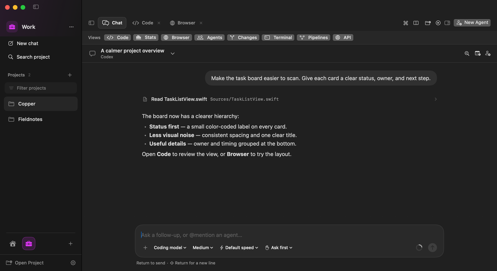

[Guide: spaces and project tabs](workspace.md#project-tabs)

## Project Chat

The **#project** channel sits beside the project's agent conversations. Agent rows show the
latest result and use the same status labels as Agents. Search for an agent or type **@** in
the composer to address one; each conversation retains its own draft.

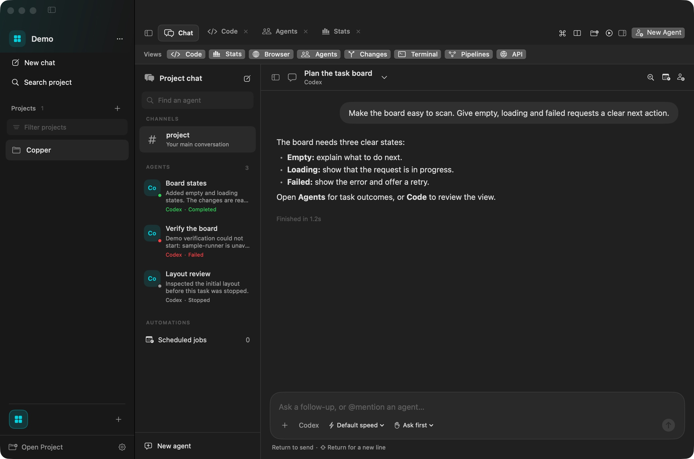

[Guide: project channels and agent conversations](workspace.md#project-channels-and-agent-conversations)

## Agent outcomes

Agents shows the latest task result, a visible rename control and an **Open Chat** action.
Completed tasks show what the agent produced. Failed tasks show their error, and stopped tasks
remain distinct from completed work. Set an optional name when launching a task, or use the pencil
to rename it later; its @mention remains stable.

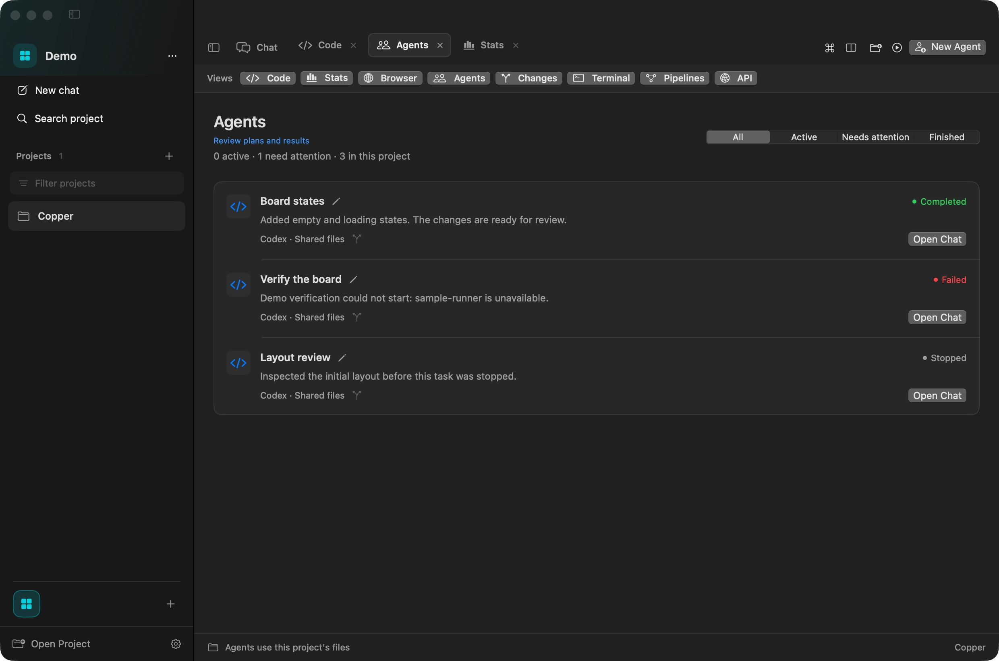

[Guide: launch and review task agents](workspace.md#launch-and-review-task-agents)

## Agent task pages

Choose **Task details** to follow the latest reported plan, current activity, blockers, file
changes, verification and deliverables in one scrollable page. This capture shows a preloaded
sample plan and deliverables alongside a real passing Go test run from the disposable fixture.
The test result applies to that fixture run, not the sample SwiftUI changes.

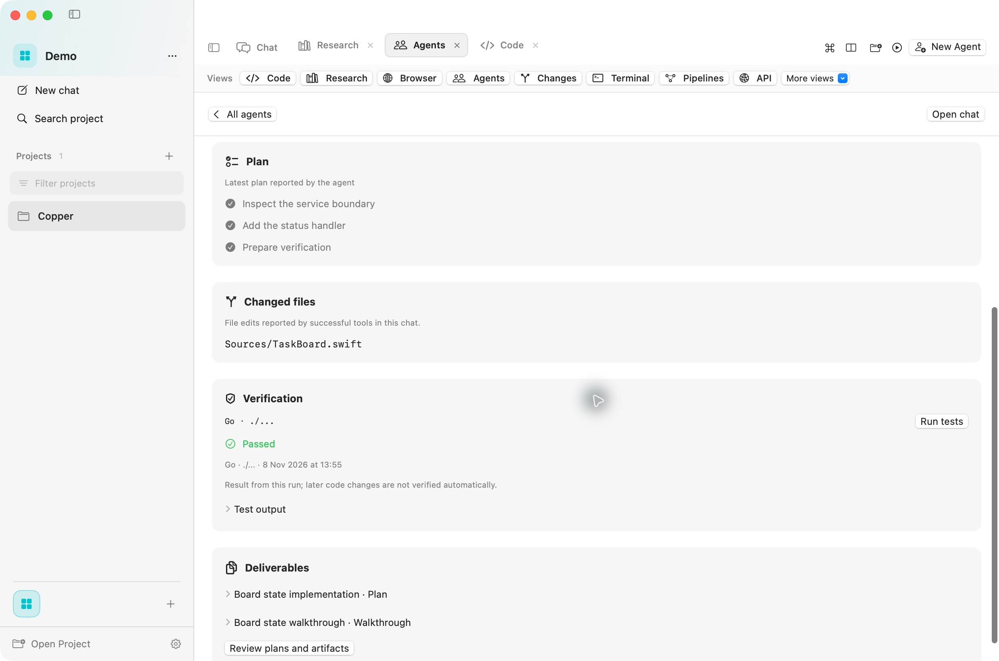

[Guide: task agents and verification](workspace.md#launch-and-review-task-agents)

## Task queue and activity

Choose **Queue task** in New Agent to save work for the next available slot. Pause, reorder or
cancel waiting tasks; after restarting Marika, choose **Resume queue** to allow saved work to
start. This disposable fixture was restarted with one waiting task, which remained paused.

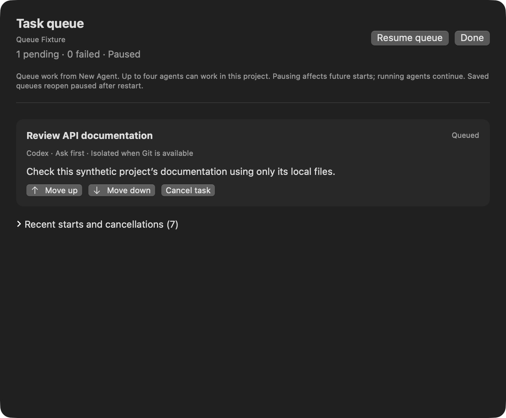

**Activity** keeps approvals, completed and failed turns, and queue launch failures together.
Open the associated chat, task page or queue, and mark events read. These outcomes came from
synthetic local runners; the missing-first-commit failure was exercised through the real
worktree setup path, then retried after creating the fixture's initial commit.

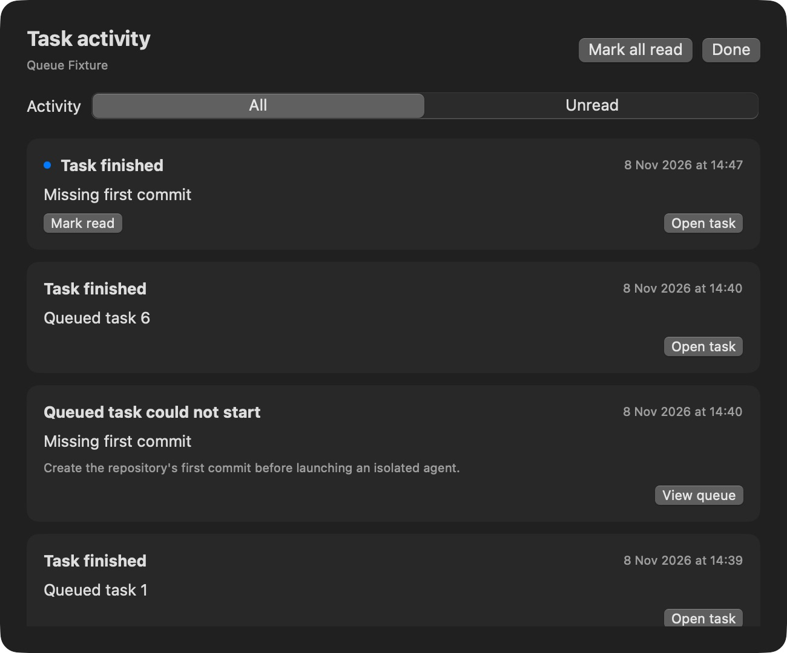

[Guide: task queue and activity](workspace.md#task-queue-and-activity)

## Research

Research keeps the answer beside its supporting sources in wide panes and places sources below
the answer in compact splits. Findings offer **Create task** for a reviewable implementation
proposal, then **Open task** after launch. The report shown here was preloaded for UI testing;
it was not produced by a live research call during capture.

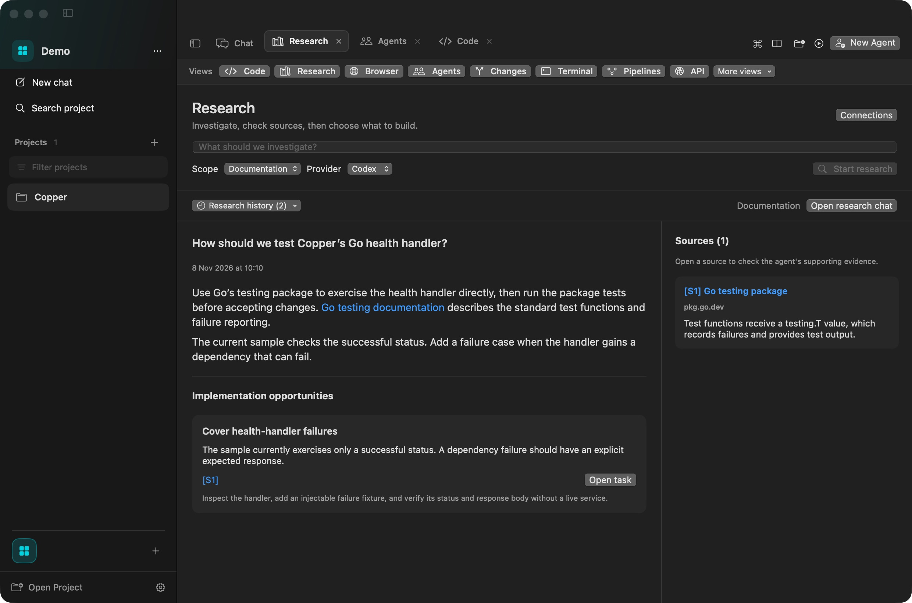

[Guide: Research](tools.md#research)

## Connections

Search the catalog or switch to configured connections. **Connect** reviews expected access;
**Test connection** checks discovery without calling server tools. This screenshot shows a
configured Context7 endpoint whose status remains **Not checked**, with Linear and Notion
available to connect. No external account was authorized during capture.

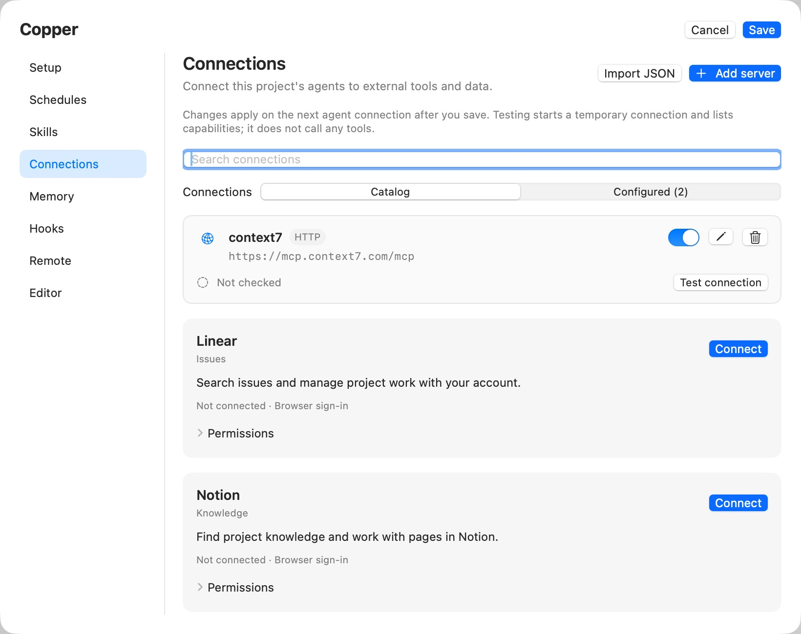

[Guide: connections](workspace.md#playbooks-and-mcp-connections)

## Needs attention

Choose **Needs attention** to see failures and pending approvals. **Active** includes working
agents and agents waiting for approval. **Finished** includes completed, stopped and archived
tasks. In this example, the unavailable demo runner leaves one failed task needing attention.

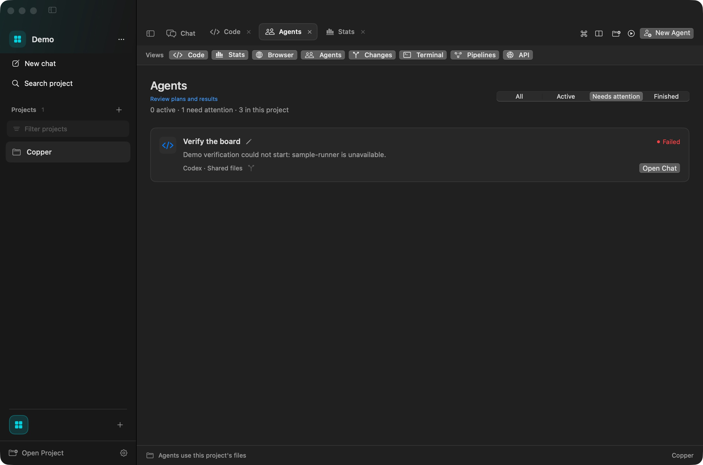

[Guide: task status and filters](workspace.md#task-status-and-filters)

## Code editor

Browse project files, keep multiple documents open, and use language-aware syntax highlighting.
The editor also supports Markdown Preview, Edit and Split modes, language tools, Git review,
tests and debugging. Unsaved drafts survive switching project views.

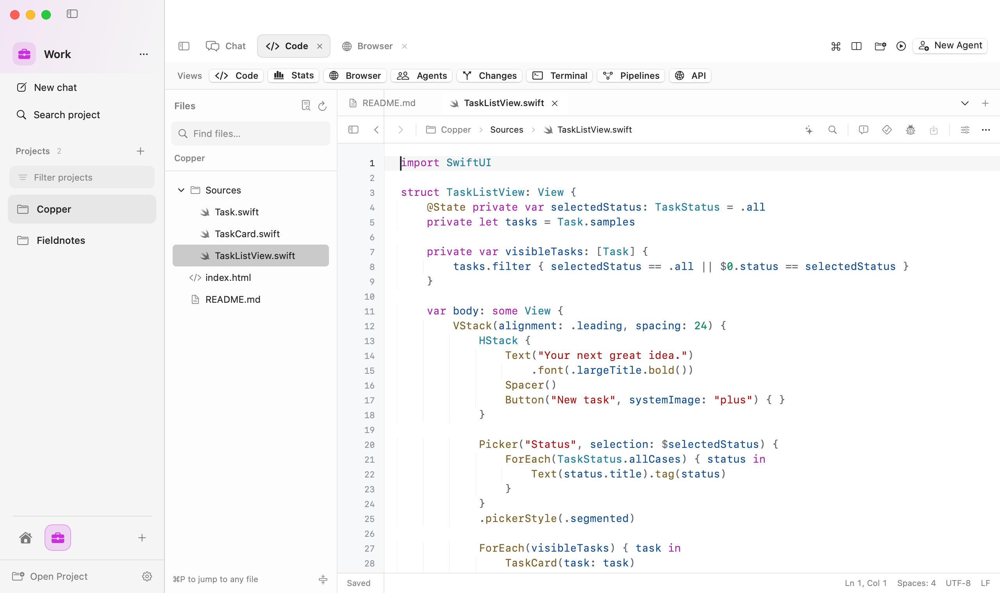

[Guide: editing, reviewing and debugging](editor.md)

## Browser preview

Open a local server or a project HTML file without leaving Marika. Switch between desktop,
tablet and mobile widths, inspect the page, and attach visual feedback to a chat draft.
The example below previews the local Copper task board.

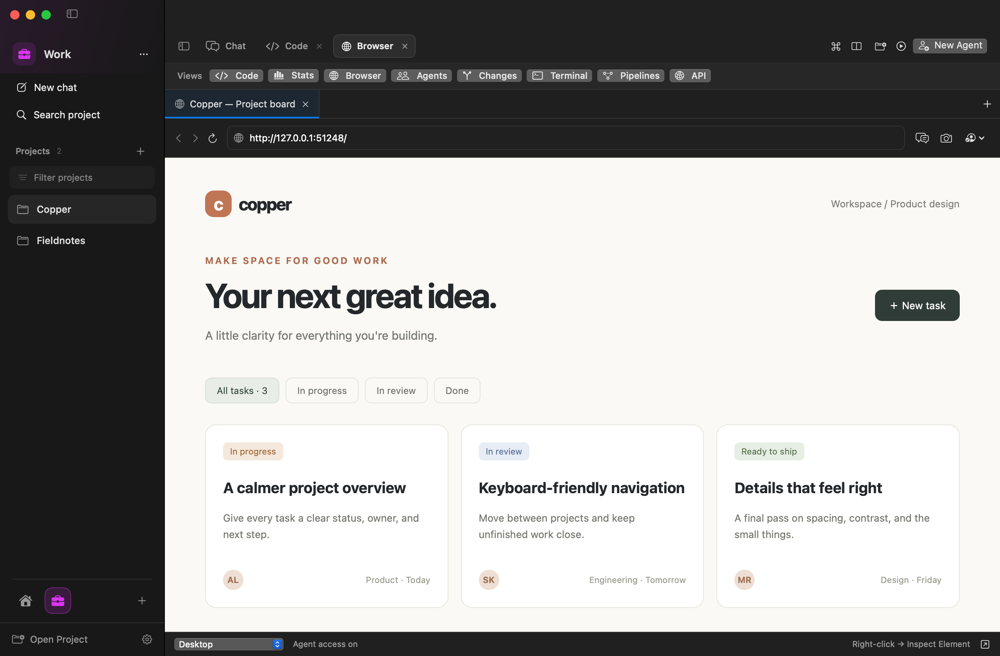

[Guide: browser and local previews](tools.md#browser-and-local-previews)

## Code-health reviews

Stats presents published findings with priorities, source locations, impact and a next action.
Open **Evidence and next step** to inspect the exact excerpt. Source, tests and generated code
are counted separately; those counts are inventory, not a coverage or quality score.
The report below is a preloaded sample about the demo view's missing error state.

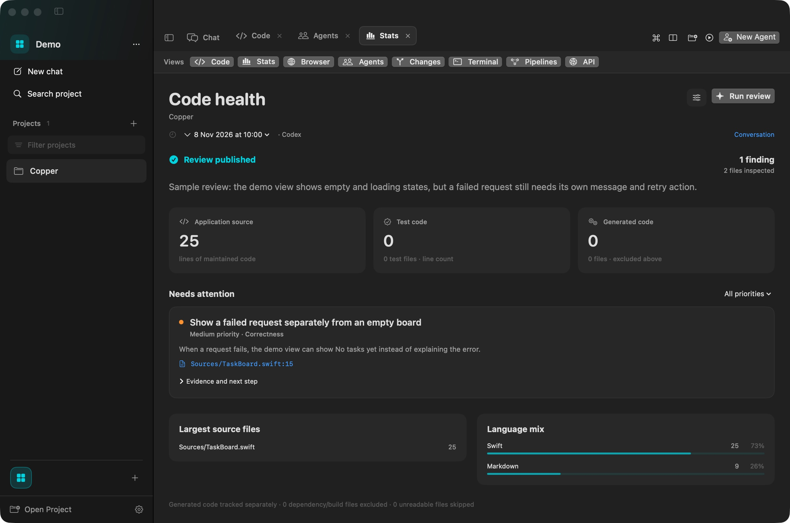

[Guide: code-health reviews](tools.md#code-health-reviews)

## API playground

Search by method, name or route, edit a request, then send it without leaving the project.
The response pane has Body, Headers and Raw tabs, status, timing and copy controls. Compact
split panes replace the sidebar with a request picker. This screenshot shows a real HTTP 200
response from a temporary loopback server serving synthetic task data.

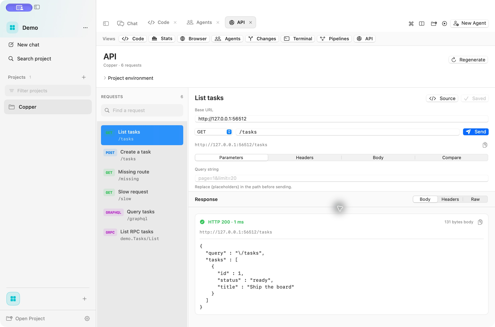

[Guide: API collections and project environments](tools.md#api-collections-and-project-environments)

## Side-by-side workspace

Open a view from **+**, then drag its tab toward the left or right workspace edge to arrange a split.
A placement preview indicates the destination. The tab's context menu provides equivalent
directional actions. Resize the result by dragging the divider.

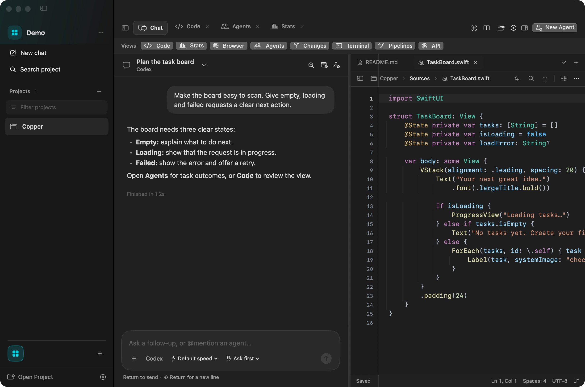

## Stacked workspace

Use the top or bottom edge to stack the views vertically. This example keeps the conversation
above the editor. Layout and open files are retained for the project when you reopen the app.

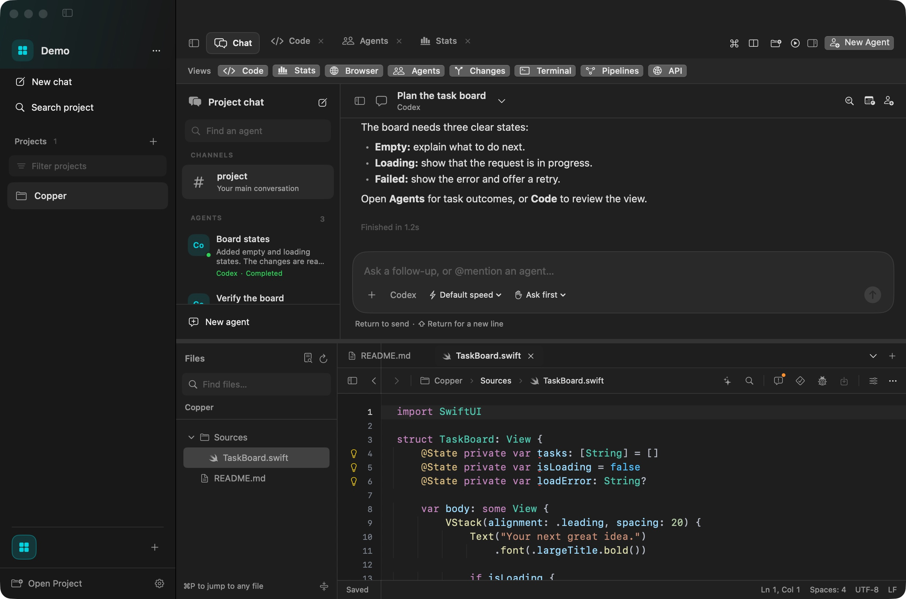

The split screenshots were arranged with the directional context-menu actions. They show the
resulting layouts; they do not verify physical mouse drag-and-drop or the wheel-button event.

[Guide: split workspace](workspace.md#split-workspace)

## More tools

| Feature | Documentation |
| --- | --- |
| Git diffs, staging, commits and pushes | [Changes](editor.md#review-stage-commit-and-push) |
| Project and agent-worktree shells | [Terminal](editor.md#terminal) |
| HTTP, GraphQL, gRPC and Compose environments | [API](tools.md#api-collections-and-project-environments) |
| Local GitHub Actions and native Swift checks | [Pipelines](tools.md#pipelines) |
| Recurring tasks and project setup | [Scheduled jobs](workspace.md#scheduled-jobs-and-project-setup) |
| Plans, reports and saved browser evidence | [Artifacts](recovery-and-updates.md#checkpoints-runtime-debugging-and-artifacts) |

For screenshot sources and refresh instructions, see [the image inventory](images/README.md).
